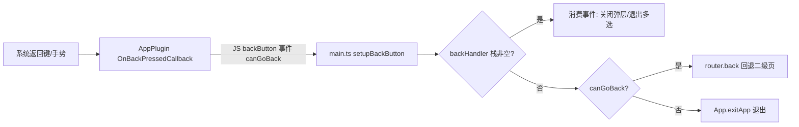

## 用户需求

Android 系统返回键（含手势返回）在任何界面都会直接退出 App，即使在表情包详情等二级界面也是如此。用户要求修复，使返回键行为符合常规移动端预期。

## 补充与明确的细节（基于代码勘察）

- 二级页（`/emoji/:id`、`/category/:id`、`/collection/:id`、`/manage-categories`）由 `router.push` 入栈，按返回应回退上一页，而非退出。
- 底部 Tab 页（首页/搜索/收藏夹）之间与 Onboarding→Home 均用 `router.replace` 切换，不堆历史；因此在无历史栈的页面按返回退出 App 属可接受的常规行为，保留。
- 额外风险点：WebView 初始 URL 为 `/`，vue-router 的 redirect 是 push 行为。若不改为 replace，引导完成后从首页按返回会退回 `/` 并被再次 redirect 回引导页，形成“返回键反复看到引导页”的循环 bug，必须一并修复。
- 底部弹层（`BaseSheet`）与首页/分类详情的多选模式打开时，返回键的直觉预期是先关闭弹层/退出多选，再走页面回退。
- Web 调试环境（无原生平台）不注册返回键监听，不影响现有 `npm run dev` 调试。
- 纯交互行为修复，不涉及 UI 改版，视觉无变化。

## 核心功能

- 二级界面按系统返回键回退上一页，不再直接退出 App
- 无历史栈时按返回键才退出 App
- 返回键优先关闭底部弹层 / 退出多选模式
- 根路径重定向改为 replace，消除返回引导页循环

## 技术栈

- 前端：Vue 3 + TypeScript + Vite + Pinia + Vue Router（既有栈，不引入新框架）
- 新增依赖：`@capacitor/app@^6.2.0`（与既有 `@capacitor/core@^6.2.2` 匹配；提供 `backButton` 事件与 `exitApp()`）
- 原生：Capacitor 6 Android（`BridgeActivity` 默认不处理返回键，由 AppPlugin 的 `OnBackPressedCallback` 接管）

## 实现策略

1. **根因修复**：安装 `@capacitor/app`，在 `src/main.ts` 注册 `App.addListener('backButton', ...)`。有 JS 监听者时 AppPlugin 的 `OnBackPressedCallback` 被启用并拦截系统返回键（payload 含 `canGoBack`，来自 `bridge.getWebView().canGoBack()`），JS 侧执行“有历史栈回退、无历史栈退出”。
2. **历史栈修正**：`src/router/index.ts` 根路径 redirect 改为函数形式并带 `replace: true`，使引导完成后历史栈为 `[/home]`，首页按返回 `canGoBack=false` 直接退出，避免退回引导页的循环。
3. **弹层/多选拦截**：新增 `src/services/backHandler.ts`，维护 LIFO 处理器栈；`BaseSheet` 打开时注册、关闭时注销；`Home.vue`/`CategoryDetail.vue` 多选模式同样注册。返回事件优先消费栈顶，未被消费才走回退/退出逻辑。每处改动约 3 行，收益直接。
4. **手工装配原生插件**：因 `cap sync`/`cap update` 在本机有 safe-delete 坑（CODEBUDDY.md §7），完全按 filesystem/share 的既有三处样板手工写入，不跑 sync；Web 资源仅用 `npx cap copy android`。
5. **Web 守卫**：`Capacitor.isNativePlatform()` 为 false 时不注册，Web 调试零影响、无控制台噪音。

## 性能与可靠性

- 监听器全局仅注册一次；返回事件为低频用户操作，无热路径开销；拦截栈 push/remove 为 O(1)。
- `router.back()` 与原生 `canGoBack` 同源于 WebView 历史，判断一致；`App.exitApp()` 仅作无历史栈时的兜底。
- 边界：快速连按返回时 `consumeBackEvent()` 同步执行无竞态；弹层关闭时同步注销处理器，避免关闭后仍被消费。
- 未引入“双击退出”提示（属产品决策，避免过度设计），后续可在同一监听器内扩展。

## 架构设计



## 目录结构（仅列改动文件）

```
emoji-ai/
├── package.json                                  # [MODIFY] 新增依赖 @capacitor/app ^6.2.0
├── src/
│   ├── main.ts                                   # [MODIFY] 注册 backButton：先消费弹层栈，再回退/退出
│   ├── router/index.ts                           # [MODIFY] 根路径 redirect 改 replace:true，防返回循环
│   └── services/
│       └── backHandler.ts                        # [NEW] 返回处理器栈（LIFO）：pushBackHandler/consumeBackEvent
├── src/components/BaseSheet.vue                  # [MODIFY] 打开注册、关闭注销返回处理器
├── src/views/Home.vue                            # [MODIFY] 多选模式注册返回处理器（退出多选）
├── src/views/CategoryDetail.vue                  # [MODIFY] 多选模式注册返回处理器（退出多选）
├── android/capacitor.settings.gradle             # [MODIFY] 手工加 include ':capacitor-app' + projectDir
├── android/app/capacitor.build.gradle            # [MODIFY] 手工加 implementation project(':capacitor-app')
├── android/app/src/main/assets/capacitor.plugins.json  # [MODIFY] 加 AppPlugin classpath 条目
├── android/app/build.gradle                      # [MODIFY] versionCode 2→3、versionName 1.0.1→1.1.0（打包前强制）
└── CODEBUDDY.md                                  # [MODIFY] §4.2 增加返回键处理映射、§2 技术栈补 @capacitor/app
```

## 关键代码结构

```ts
// src/services/backHandler.ts（接口签名；实现遵循现有 services/ 目录风格与中文注释约定）
export type BackHandler = () => boolean // 返回 true 表示已消费本次返回事件
export function pushBackHandler(handler: BackHandler): () => void // 注册，返回注销函数
export function consumeBackEvent(): boolean // 栈非空则调用栈顶；返回是否被消费
```

`main.ts` 处理逻辑（文字描述）：新增 `setupBackButton()`，先判 `Capacitor.isNativePlatform()`；内部 `App.addListener('backButton', ({ canGoBack }) => { if (consumeBackEvent()) return; if (canGoBack) router.back(); else App.exitApp(); })`；在 `createApp(...).use(router).mount('#app')` 之后调用。`router/index.ts` 根路由改为 `{ path: '/', redirect: () => ({ path: '/onboarding', replace: true }) }`。