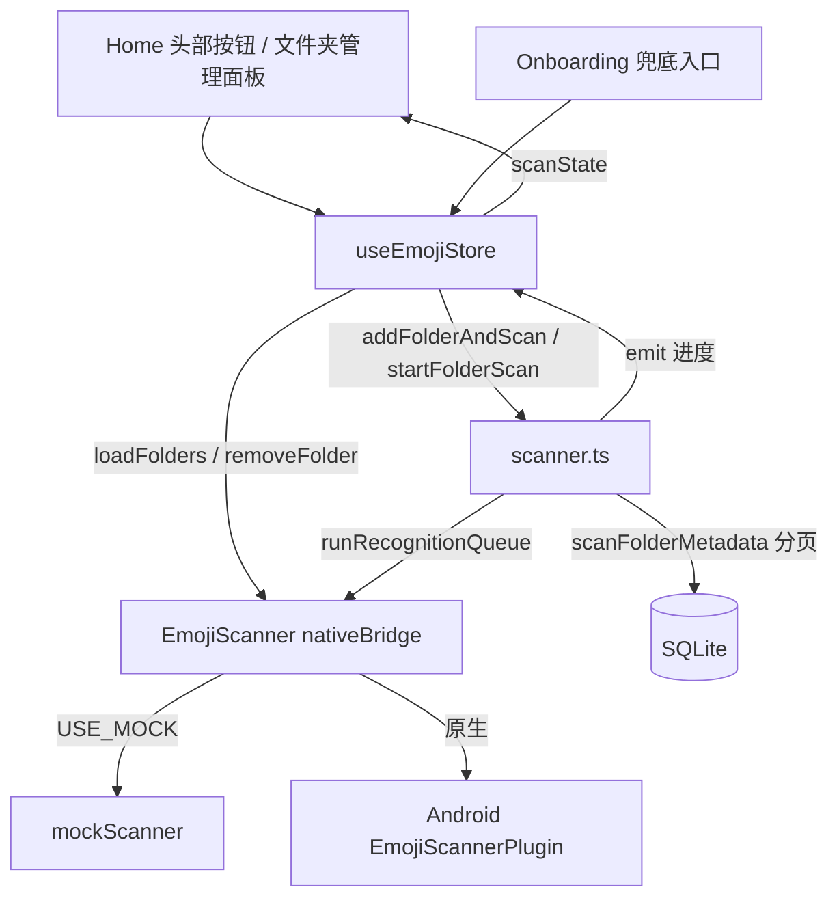

## 用户需求

为「表情包管家」App 增加「手动选择文件夹」能力，作为自动扫描的补充，解决自动扫描（全设备图片/GIF 扫描）扫不到散落表情包的问题。底层 `openFolderPicker / scanFolder / listFolders / removeFolder` 在 nativeBridge、mockScanner、Android 原生插件中均已实现，本次重点是上层编排与 UI 接入。

## 产品概述

在首页与权限引导页提供「手动选择文件夹」入口。用户可调用系统目录选择器挑选表情包所在文件夹，App 将该文件夹内图片/GIF 扫描入库并跑端侧 AI 识别（OCR+情感分类），与现有自动扫描流程一致。同时提供文件夹管理面板，可查看已选文件夹、对每个文件夹重扫或移除，可反复补充多个目录。

## 核心功能

- 一键快速选择并扫描：首页按钮调起系统目录选择器，选完立即扫描该文件夹并入库+识别。
- 文件夹管理面板：底部弹层列出已选文件夹，逐项「扫描」「移除」，底部「添加文件夹」继续选择。
- 扫描流程复用：所选文件夹扫描后执行元数据入库 + 端侧 AI 识别，可搜索与分类。
- 兜底入口：权限拒绝/未授权场景下，引导页提供「改为手动选择文件夹」入口。
- 顺带修正底层 `nativeBridge` 字段映射 bug（真机 `mimeType` 丢失、`mtime` 秒/毫秒单位错位），提升自动扫描与文件夹扫描的正确性。

## 技术栈

- 前端框架：Vue 3 + TypeScript（已有）
- 移动端容器：Capacitor 6（已有，Android 原生插件已就绪）
- 状态管理：Pinia（已有 `emoji` store）
- 样式：Tailwind CSS（已有自定义 `btn/card/chip/sheet` 设计令牌）
- 数据源：SQLite（`@capacitor-community/sqlite` / sql.js），复用 `emojiRepo`、`categoryRepo`

## 实现策略

在现有自动扫描链路（`scanner.scanMetadata` → `toRecord` → `upsertEmojisBatch` → `runRecognitionQueue` → `emit` 进度）之上，新增"单文件夹"编排，并复用原生 `EmojiScanner` 的 `openFolderPicker/scanFolder/listFolders/removeFolder`。关键决策：

1. **归一化层（nativeBridge）**：新增 `normalizeScanItem`，统一 `mime ?? mimeType`、缺 `name` 时由 path 推导、`mtime` 秒→毫秒。同时修复自动扫描与文件夹扫描两处映射，避免真机下字段丢失与增量比对错位。
2. **单文件夹扫描编排（scanner.ts）**：`scanFolderMetadata(folder)` 分页调用 `EmojiScanner.scanFolder`，复用 `toRecord` 与批量 upsert，复用 `emit` 推送进度；`scanFolderAndRecognize(folder)` = 元数据扫描 + `runRecognitionQueue()`（全局处理 pending，与 `startFullScan` 一致）。
3. **文件夹管理（scanner.ts + store）**：`listSavedFolders`/`addFolder`/`removeSavedFolder` 直接代理原生（原生 `openFolderPicker` 已通过 `FolderStore` 持久化授权，`listFolders` 读取之，无需前端自管持久化）。
4. **并发守卫**：新增 `folderScanning` 标志，与现有 `metadataScanning`/`recognizing` 隔离，避免自动扫描与文件夹扫描互相打断；UI 依据 `scanState.phase` 禁用按钮。

**性能与可靠性**：文件夹扫描采用与自动扫描相同的 `PAGE_SIZE=100` 分页 + `UPSERT_FLUSH=200` 批量入库，控制内存峰值；识别复用每批 20 张串行队列。文件夹路径天然去重（按 path 唯一），移除文件夹仅删授权记录，不影响已入库表情（保持向后兼容）。

## 实现要点（防回归）

- 复用现有 `onProgress/emit` 进度机制与 `BaseSheet/EmptyState/ScanProgress` 组件，不新增组件样式体系。
- `normalizeScanItem` 对 mock 数据保持透明（mock 已返回 `mime`/`name`/`mtime` 毫秒，归一化后不变），保证电脑端调试不受影响。
- 权限判断沿用 `checkPermission`/`ensurePermission`；手动选文件夹不依赖"全部文件访问权限"（走 SAF 授权），因此 Onboarding 兜底入口在拒绝场景下仍可用。
- 不改动 Android 原生插件（已实现），不改动 `mockScanner.ts` 与 `types/index.ts`（类型已齐备）。

## 架构设计



## 目录结构与改动文件

```
src/
├── services/
│   └── nativeBridge.ts   # [MODIFY] 新增 normalizeScanItem；scanImages 与 scanFolder 映射改为经归一化（修 mime/mimeType、mtime 秒→毫秒、name 推导）
├── services/
│   └── scanner.ts        # [MODIFY] 导入 SavedFolder；新增 listSavedFolders / addFolder / removeSavedFolder / scanFolderMetadata / scanFolderAndRecognize；新增 folderScanning 并发守卫
├── stores/
│   └── emoji.ts          # [MODIFY] 新增 savedFolders 状态与 loadFolders / addFolder / addFolderAndScan / startFolderScan / removeFolder；init() 内调用 loadFolders
└── views/
    ├── Home.vue          # [MODIFY] 头部新增「选择文件夹」快捷按钮（addFolderAndScan）；新增文件夹管理 BaseSheet（列出已选文件夹，逐项扫描/移除，底部添加文件夹）；扫描中禁用按钮并复用 scanState 进度；空态补充手动选文件夹引导
    └── Onboarding.vue    # [MODIFY] 权限拒绝/跳过场景下新增「改为手动选择文件夹」入口（addFolderAndScan 后跳 Home）
```

## 关键代码结构

```ts
// nativeBridge.ts
function normalizeScanItem(f: {
  path: string; name?: string; mime?: string; mimeType?: string;
  mtime?: number; size?: number; width?: number; height?: number;
  isGif?: boolean; thumbPath?: string;
}): NativeScanItem

// scanner.ts
export async function listSavedFolders(): Promise<SavedFolder[]>
export async function addFolder(): Promise<SavedFolder | null>
export async function removeSavedFolder(treeUri: string): Promise<void>
export async function scanFolderMetadata(folder: SavedFolder): Promise<{ added: number; total: number }>
export async function scanFolderAndRecognize(folder: SavedFolder): Promise<number>
```

## 设计风格

延续现有 App 的温暖活泼风格（主色珊瑚红 #FF6B6B → 暖橙 #FF8E53 渐变、薄荷绿点缀 #4ECDC4，圆角卡片、轻投影、底部弹层）。本次新增 UI 不引入新设计语言，完全复用既有 `btn / card / chip / BaseSheet` 令牌，保证视觉一致。

## 页面与区块设计

### Home 首页（移动端竖屏）

1. **顶部标题栏（已有）**：右上角「重新扫描」旁新增「选择文件夹」次级按钮（`btn-ghost` + `FolderOpen` 图标），点击即调起系统选择器并立即扫描。
2. **文件夹管理弹层（新增 BaseSheet）**：从底部滑出（`rounded-sheet`），标题「我的文件夹」。

- 列表区：每条已选文件夹一行，左侧文件夹图标 + 名称（`text-sm`），右侧两个轻量操作：`扫描`（刷新图标，扫描中显示旋转）、`移除`（文字按钮，danger 色）。
- 空态：列表为空时居中提示「还没有手动添加的文件夹，点击下方添加」。
- 底部操作：`添加文件夹` 主按钮（渐变 `btn-primary`），点击调起选择器。

3. **空态区（已有 EmptyState）**：描述补充「或手动选择表情包所在文件夹」。
4. **扫描进度（已有 ScanProgress）**：复用 `scanState`，文件夹扫描时同样展示进度条与文案。

### Onboarding 引导页（移动端竖屏）

- 权限拒绝态：在红色提示下方新增 `改为手动选择文件夹` 文字按钮（accent 色），点击 `addFolderAndScan` 后跳 Home，直接对应"防止自动扫描扫不到"。

## 交互细节

- 弹层滑入用既有 `animate-fade-up`；按钮 `active:scale` 微反馈；扫描中按钮 `opacity-50` 禁用并转圈。
- 文件夹名称超长省略（`truncate`）；移除后列表即时更新（`savedFolders` 响应式）。