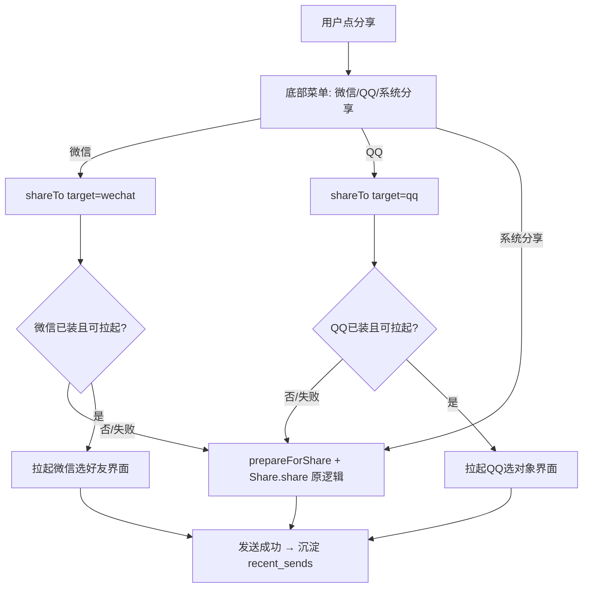

## 产品概述

将现有「复制到缓存 → 系统分享面板选 App」的两步分享，改为一次原生调用**直接拉起微信/QQ 的转发界面**（点一下直达选好友/群），并保留「系统分享」作为兜底入口，应对微信/QQ 未安装或被拦截的情况。

## 核心功能

- 详情页与首页长按面板：分享按钮改为弹出底部菜单，含「微信 / QQ / 系统分享（更多）」三项。
- 点「微信」：`shareTo({ target:'wechat' })` 跳过系统面板，直接拉起微信「选择发送对象」界面。
- 点「QQ」：`shareTo({ target:'qq' })` 直接拉起 QQ 选择对象界面。
- 点「系统分享」：沿用原有 `prepareForShare + Share.share` 系统面板逻辑。
- 兜底：微信/QQ 未安装或拉起失败（`ActivityNotFoundException`）时，自动回退系统分享并轻提示，避免「点了没反应」。
- 发送成功后仍沉淀「最近发送」（`recent_sends`），与悬浮窗共用数据源。
- 版本号按项目约定递增。

## 技术栈

- 前端：Vue 3 + TypeScript + Vite + Pinia + Tailwind CSS（沿用项目现有栈）
- 原生：Capacitor 6 Android 插件（Java），复用 `ThumbnailUtil.copyToCache` 与 `FileProvider` 授权
- 分享：由 `@capacitor/share` 系统面板，升级为原生 `Intent.ACTION_SEND` + `setPackage` 直发

## 实现方案

**核心策略**：在 `EmojiScannerPlugin.java` 新增单个原生方法 `shareTo({ path, target })`，统一完成「复制缓存 → FileProvider 授权 → 按 target 直发微信/QQ 或回退系统面板」。前端 `share.ts` 拆出 `shareToWechat` / `shareToQQ` / `shareSystem`，前两者调 `EmojiScanner.shareTo`，失败即回退 `shareSystem`。UI 把分享按钮改为复用现有 `BaseSheet` 的底部菜单。

**关键决策与权衡**

1. **新增原生方法而非改造 `prepareForShare`**：`prepareForShare` 仅做缓存复制且被悬浮窗等多处复用，单独新增 `shareTo` 职责单一、零回归风险，符合 SoC。
2. **安装判断 + 回退兜底**：微信对第三方 `ACTION_SEND` 拉起较敏感，必须先用 `PackageManager.getPackageInfo` 判安装、`try-catch ActivityNotFoundException`，返回 `{ launched:false, reason }` 让前端回退，杜绝「点了无反应」。
3. **`startActivity` 主线程**：Capacitor `@PluginMethod` 默认在后台线程执行，原生侧用 `getActivity().runOnUiThread(() -> startActivity(...))` 包裹，避免 `CalledFromWrongThread` 异常。
4. **复用现有工具**：`EmojiScannerPlugin` 当前无 `AUTHORITY`/`toRealFile`/`guessMime`/`safeName`（`FloatingWindowService` 中是 private）。方案在 `EmojiScannerPlugin` 补充 `AUTHORITY = "com.emoji.ai.fileprovider"` 常量并新增 `FileProvider` import，就近补充 `toRealFile`/`guessMime`/`safeName` 私有方法；为 DRY，建议将这三个方法提取到 `ThumbnailUtil` 静态方法供两处复用（不改 `FloatingWindowService` 亦可，仅就近复制亦可接受）。

**数据流（Mermaid）**



## 实现注意

- **授权一致性**：`FileProvider` 的 `authority` 必须与 `android/app/src/main/res/xml/file_paths.xml`（及 `FloatingWindowService` 使用的 `com.emoji.ai.fileprovider`）完全一致，否则 `getUriForFile` 抛异常。
- **GIF 提示**：微信经 `ACTION_SEND` 发 GIF 可能仅首帧，QQ 支持较好；UI 对 GIF 可轻提示，但不阻断流程。
- **keep-alive 兼容**：分享菜单用 `BaseSheet`（已支持 teleport/ESC），与现有弹层一致，不影响 `App.vue` 滚动记忆。
- **Web 调试**：`USE_MOCK` 时 `mockShareTo` 直接返回 `{ launched:true }`，保证浏览器可联调菜单 UI。
- **版本号**：交付前 `android/app/build.gradle` 第 18–19 行 `versionCode` +1、`versionName` 语义递增（强制约定）。

## 架构设计

前端 `UI（详情页/首页）→ store.share(path, target) → share.ts（shareToWechat/QQ/System）→ EmojiScanner 门面 → 原生 EmojiScannerPlugin.shareTo`，与现有分享链路同构，仅在「门面之后」由系统面板改为直发 + 兜底，向后兼容 `system` target。

## 目录结构

```
android/app/src/main/java/com/emoji/ai/
└── EmojiScannerPlugin.java    # [MODIFY] 新增 shareTo({path,target})：复制缓存(ThumbnailUtil.copyToCache) → FileProvider.getUriForFile → 按 target setPackage(com.tencent.mm / com.tencent.mobileqq) 直发，或 target=system 走原 chooser；补充 AUTHORITY 常量、FileProvider import、toRealFile/guessMime/safeName 工具方法（或提取到 ThumbnailUtil）；未安装/失败返回 {launched:false,reason};startActivity 用 runOnUiThread 包裹。
src/
├── types/index.ts             # [MODIFY] EmojiScannerPlugin 接口增加 shareTo(options:{path:string;target:'wechat'|'qq'|'system'}):Promise<{launched:boolean;reason?:string}>
├── services/nativeBridge.ts   # [MODIFY] 新增 shareTo(opts) 封装并入 EmojiScanner 门面；USE_MOCK 走 mockShareTo
├── services/mockScanner.ts    # [MODIFY] 新增 mockShareTo（Web 默认返回 {launched:true}）
├── services/share.ts          # [MODIFY] 重构为 shareToWechat/shareToQQ/shareSystem；前两者调 EmojiScanner.shareTo，launched:false 时回退 shareSystem（保留 prepareForShare+Share.share 旧逻辑）并 toast 提示
├── stores/emoji.ts            # [MODIFY] share(path, target?) 增加 target 参数转发 share.ts；成功仍沉淀 recent_sends
├── views/EmojiDetail.vue      # [MODIFY] onShare 改为弹底部菜单（微信/QQ/系统分享），点选调 emojiStore.share(path, target)；第 221–228 行分享按钮保留，菜单复用 BaseSheet
└── views/Home.vue             # [MODIFY] 长按面板 onShare（第 128 行）与「分享到微信/QQ」按钮（第 489–494 行）改为弹菜单或拆分微信/QQ/系统分享入口
android/app/build.gradle       # [MODIFY] versionCode +1、versionName 语义递增
```

## 关键代码结构

```typescript
// src/types/index.ts —— EmojiScannerPlugin 新增契约
shareTo(options: {
  path: string
  target: 'wechat' | 'qq' | 'system'
}): Promise<{ launched: boolean; reason?: 'NOT_INSTALLED' | 'LAUNCH_FAILED' | string }>
```

## 设计风格

沿用项目现有 Tailwind + ink 色板的轻量风格，不引入新组件库。分享入口由单一「分享」按钮升级为「底部弹出菜单」，复用现有 `BaseSheet`（teleport 到 body、点击遮罩/ESC 关闭）。

## 页面/弹层设计

### 分享底部菜单（详情页 + 首页长按面板共用）

- **触发**：点击原「分享」按钮，底部滑入半屏菜单（带遮罩 + 轻微上浮动画）。
- **区块 1 标题**：「分享到」小字提示，右对齐关闭叉。
- **区块 2 选项列表**：三项等宽卡片行，每项含图标 + 文字：
- 微信（绿色微信图标，文字「微信」）
- QQ（蓝色 QQ 图标，文字「QQ」）
- 系统分享（通用分享图标，文字「系统分享（更多）」）
- **区块 3 取消**：底部「取消」按钮，点按或点遮罩关闭。
- **交互**：选项 hover/focus 有 `bg-black/5` 浅底反馈；GIF 时「微信」项下方一行浅灰小字「微信可能仅发送首帧」。点选后关闭弹层并触发对应 `emojiStore.share(path, target)`。

## 字体与颜色（沿用项目 ink 体系）

- 标题 14px / 500；选项文字 15px / 500；提示 12px / 400。
- 主色（按钮/强调）蓝色系；背景白 #FFFFFF / 灰 #F9FAFB；文字 ink #1F2937、次要 #6B7280、浅 #9CA3AF；微信绿 #07C160、QQ蓝 #12B7F5、错误红 #DC2626。