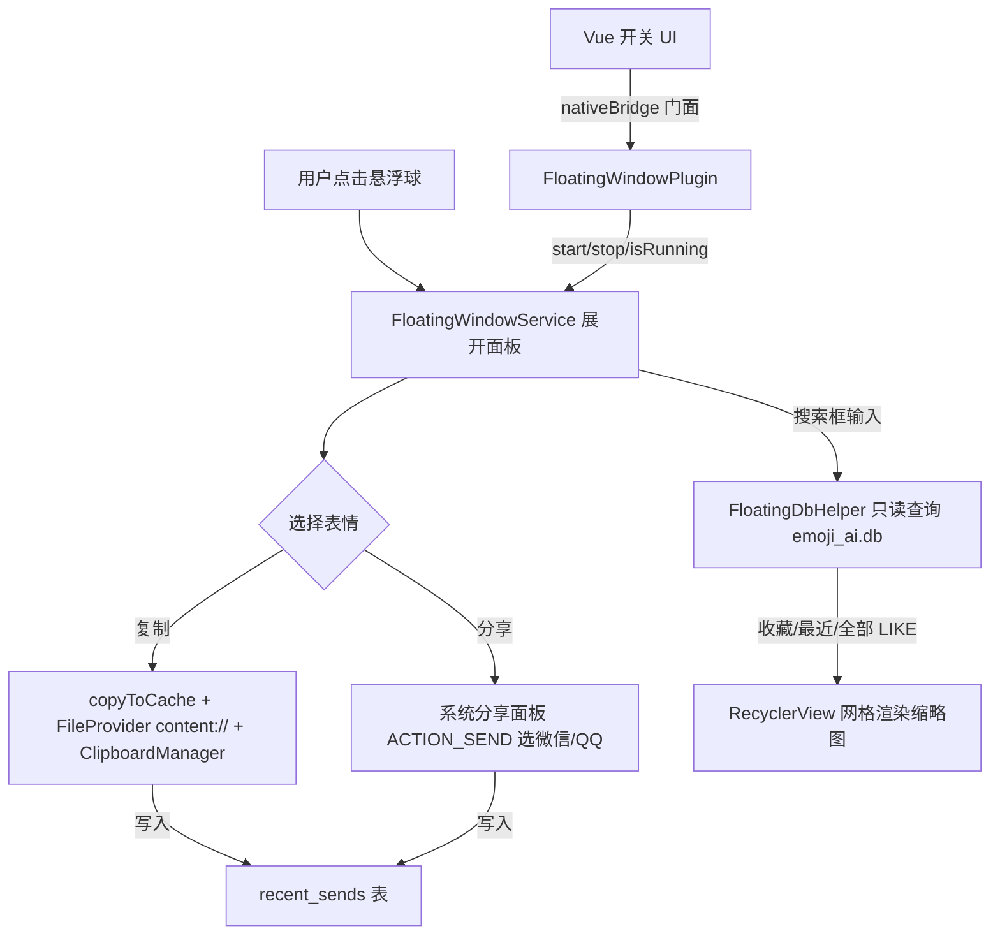

## 用户需求

在聊天软件（微信/QQ）中无需打开 App、无需多次跳转即可快速发送表情包：常驻系统悬浮球，点开后直接选表情，支持「复制到剪贴板」与「调起系统分享面板」两种发送方式。

## 产品概述

全新「悬浮窗快速发送」功能（系统级）。在任意 App 上方常驻一个可拖拽的悬浮球，点击展开表情面板；面板顶部为收藏与最近发送快捷区，下方为可搜索的全部表情网格；点选表情即时复制或分享，用完即收起，不打断当前聊天。需用户授权「显示在其他应用上」（`SYSTEM_ALERT_WINDOW`，本地权限，不联网、不上传）。

## 核心功能

- 悬浮球常驻屏幕边缘、可拖拽、点击展开/收起表情面板
- 面板内「收藏 + 最近发送」快捷区，下方全部表情网格 + 关键词搜索框（分页加载）
- 单表情「复制到剪贴板」（提示去聊天粘贴）与「分享」（系统分享面板选微信/QQ）两个动作
- 「最近发送」记录（新增 recent_sends 表），每次发送自动沉淀
- App 内悬浮窗开关与权限引导页、运行状态同步
- 完全复用现有缩略图与离线数据，不接入微信/QQ SDK、不联网

## 技术栈选择

- 原生 Android（Java，现有工程）：`WindowManager` 悬浮窗、`Service`、`ClipboardManager`、`FileProvider`、SQLite 只读访问、RecyclerView 网格。
- 前端 Vue3 + TypeScript + Capacitor：`App.vue`/`Home.vue` 悬浮窗开关 UI、权限引导、`src/services/nativeBridge.ts` 插件门面。
- 复用：`ThumbnailUtil`（缩略图缓存 + `copyToCache`）、`src/db/repositories/emoji.ts` 的查询语义（收藏/搜索/LIKE）、现有 `EmojiScannerPlugin` 插件注册范式。

## 实现方案

采用「原生 Service 悬浮窗 + 原生只读 SQLite」架构，前端仅负责开关与权限引导，悬浮窗内所有渲染与发送动作在原生层完成（按用户选择不嵌 WebView，最轻量流畅）。

**关键决策与取舍：**

1. **悬浮窗独立 Service 直接读库**：原生 `FloatingDbHelper` 以只读方式打开同一个 `emoji_ai` 数据库文件（与主进程 Capacitor SQLite 同进程、并发读允许），避免经 WebView 桥接的开销与延迟；写 `recent_sends` 走轻量 INSERT/UPDATE，短暂写锁对主进程影响可忽略。
2. **复制用 FileProvider 暴露 content://**：Android 7+ 剪贴板 `ClipData.newUri` 仅接受 `content://`，故复制/分享的图片先经 `ThumbnailUtil.copyToCache` 落入缓存子目录，再用 `FileProvider.getUriForFile` 转 `content://` 并附 `FLAG_GRANT_READ_URI_PERMISSION`。
3. **分享从 Service 起 Activity**：用户手势触发，附 `FLAG_ACTIVITY_NEW_TASK`，调 `ACTION_SEND` + `image/*` + `EXTRA_STREAM`，`Intent.createChooser` 选微信/QQ。
4. **最近发送基于新表**：现有 `getRecent()` 按 `created_at` 排序并非真实发送记录，悬浮窗「最近」必须基于新增 `recent_sends(emoji_id, sent_at)`，每次复制/分享成功即写入。
5. **权限先行**：`start()` 先 `Settings.canDrawOverlays` 校验，未授权 `reject` 并引导前端跳转 `ACTION_MANAGE_OVERLAY_PERMISSION`。

## 实现要点（执行须知，防回退）

- **数据库路径与 WAL（最高风险）**：实现前须确认 `@capacitor-community/sqlite` 在 Android 的真实文件路径（通常 `getFilesDir()/databases/emoji_ai`，无 `.db` 后缀）及 journal 模式（默认 WAL）。悬浮窗只读打开需兼容 `-wal/-shm`：确保缓存目录可读，或读前对主库做 checkpoint，避免读不到最新数据或打开失败。**严禁凭猜测硬编码路径**，应直接读插件源码或日志核实。
- **统一 `deleted_at = 0` 过滤**：悬浮窗所有查询（收藏/全部/搜索）必须过滤已软删表情，与现有读路径一致。
- **SQL 转义**：手写 SQL 字符串一律 `esc()`（`String(s ?? '').replace(/'/g,"''")`），原生侧用参数化查询 `?` 占位，杜绝 `undefined.replace` 式崩溃。
- **schema 行尾**：`schema.sql` 严禁 CRLF（按 `;\n` LF 拆分）；新增 `recent_sends` 表的建表语句写进同一份文件并随 `initSchema` 执行，同时补幂等迁移 `ensureRecentSendsTable()`（参照 `ensureDeletedAtColumn` 用 `PRAGMA table_info` 守卫）。
- **内存**：RecyclerView 固定 item 尺寸，缩略图直接 `BitmapFactory.decodeFile` 加载已采样（360px）的 `cache/thumbs/*.jpg`；面板收起/销毁时及时 `recycle` 离屏 Bitmap，控制常驻内存。
- **权限/版本红线**：`AndroidManifest.xml` 仅新增 `SYSTEM_ALERT_WINDOW` 权限（敏感本地权限，不涉及存储全设备权限，符合离线原则）；打包前 `versionCode` +1、`versionName` 语义递增，`applicationId` 固定 `com.emoji.ai`。
- **不破坏既有**：不改动 keep-alive 滚动记忆、SAF 授权、软删除/回收站逻辑；新增插件与前端开关为增量，不影响现有页面。

## 架构设计



## 目录结构

```
android/app/src/main/java/com/emoji/ai/
├── FloatingWindowPlugin.java      # [NEW] Capacitor 插件(@CapacitorPlugin name=FloatingWindow)，暴露 start/stop/isRunning/openSettings；start 前校验 SYSTEM_ALERT_WINDOW 权限
├── FloatingWindowService.java      # [NEW] 核心 Service：WindowManager 添加悬浮球与面板 View，处理拖拽/展开/收起、搜索输入、点选复制/分享、写 recent_sends
├── FloatingDbHelper.java           # [NEW] 只读访问 emoji_ai.db：getFavorites/getRecentSends/getAll/search 四查询（统一 deleted_at=0），openReadOnly 兼容 WAL
└── res/layout/                     # [NEW] floating_ball.xml / floating_panel.xml / floating_emoji_item.xml 布局
android/app/src/main/res/xml/
└── floating_file_paths.xml         # [NEW] FileProvider paths，暴露 cache/clip、cache/share 供复制与分享的 content://
android/app/src/main/AndroidManifest.xml   # [MODIFY] 加 SYSTEM_ALERT_WINDOW 权限、FloatingWindowService 声明、FileProvider 注册
android/app/build.gradle            # [MODIFY] versionCode +1、versionName 语义递增
src/
├── types/index.ts                  # [MODIFY] 新增 FloatingWindowPlugin 接口契约与 NativeEmojiItem 类型
├── services/nativeBridge.ts        # [MODIFY] 注册并暴露 FloatingWindow 门面（start/stop/isRunning/openSettings）
├── db/schema.sql                   # [MODIFY] 新增 recent_sends 表 DDL（LF 行尾）
├── db/database.ts                  # [MODIFY] 新增 ensureRecentSendsTable 幂等迁移（PRAGMA 守卫）
├── db/repositories/emoji.ts        # [MODIFY] 新增 recordSend(id) 写入 recent_sends（供 App 内分享也沉淀最近，可选对齐）
└── views/Home.vue                  # [MODIFY] 顶栏/文件夹面板新增「悬浮窗」开关与权限引导入口，调用 nativeBridge 同步运行状态
```

## 关键代码结构

```java
// FloatingWindowPlugin.java（插件门面契约，与 nativeBridge 对应）
@CapacitorPlugin(name = "FloatingWindow")
public class FloatingWindowPlugin extends Plugin {
    @PluginMethod public void start(PluginCall call);      // 校验权限后 startService
    @PluginMethod public void stop(PluginCall call);       // stopService
    @PluginMethod public void isRunning(PluginCall call);  // 返回 { running: boolean }
    @PluginMethod public void openSettings(PluginCall call);// 跳转悬浮窗权限设置页
}

// FloatingDbHelper.java（只读查询核心签名）
public final class FloatingDbHelper {
    public static FloatingDbHelper openReadOnly(Context ctx); // 打开 emoji_ai.db，OPEN_READONLY
    public List<EmojiItem> getFavorites(int limit, int offset);
    public List<EmojiItem> getRecentSends(int limit, int offset); // JOIN recent_sends
    public List<EmojiItem> getAll(int limit, int offset);
    public List<EmojiItem> search(String kw, int limit, int offset); // ocr_text/tags LIKE
    public void recordSend(String emojiId); // 写 recent_sends
}
```