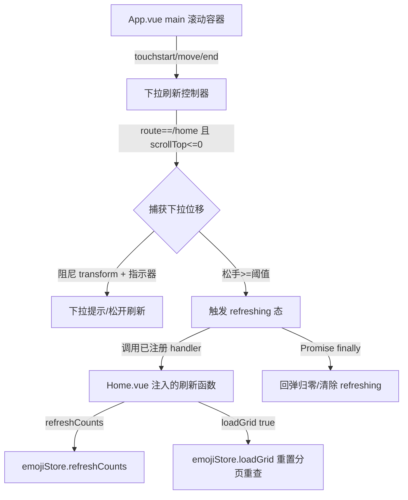

## 用户需求

在表情搜搜首页增加「划到顶之后刷新」机制：用户在表情列表顶部继续用手指下拉，松手后触发刷新，并带有下拉加载动画（类似微信/主流 App 的下拉刷新体验）。

## 产品概述

为已扫描出表情包的首页补充下拉刷新交互：当首页滚动容器处于最顶端时检测到下拉手势，展示下拉指示器（下拉提示 → 松开刷新 → 正在刷新），松手且超过阈值后执行刷新，刷新结束后指示器回弹归零。

## 核心功能

- 下拉手势识别：仅在首页且滚动到顶部时激活下拉；下拉位移带阻尼，松手超阈值触发刷新
- 下拉指示器：跟随手势露出加载圈与状态文案（下拉刷新 / 松开刷新 / 正在刷新），松手回弹动画
- 刷新动作：从数据库重新拉取当前筛选（全部或某收藏夹）下的表情网格，并刷新总数与待识别计数，不涉及文件夹扫描
- 边界兼容：非首页不激活；刷新/扫描进行中不重复触发；与现有 keep-alive 滚动位置记忆逻辑互不干扰

## 技术栈

- 前端：Vue 3 + TypeScript + Vite + Pinia + Tailwind CSS（沿用现有项目栈，不引入新库）
- 手势方案：原生 `touchstart/touchmove/touchend` 事件 + CSS `transform: translateY` 实现阻尼位移与回弹（GPU 友好，避免重排）；Web 调试可加 `pointer`/`mouse` 兜底
- 跨组件通信：Vue `provide`/`inject`（App.vue 承载手势与滚动容器，Home.vue 注入并注册自己的刷新回调）

## 实现方案

### 总体策略

实际滚动容器是 `App.vue` 的 `<main ref="mainRef">`（非 Home.vue 内部），因此下拉手势必须在 `App.vue` 监听 `mainRef`。`App.vue` 用一个轻量下拉刷新控制器维护「下拉位移 / 刷新态 / 已注册回调」，并通过 `provide` 暴露 `setHandler(fn | null)` 接口；`Home.vue` 在进入首页（`onActivated`）时注入并注册自己的刷新函数，离开（`onDeactivated`）时注销。刷新动作完全复用现有 store：`emojiStore.refreshCounts()` + `emojiStore.loadGrid(true)`（已支持清空 items、重置分页、按 `filterCollectionId` 重查），**不新增任何 store/repo 方法，不改动数据库 schema 与扫描链路**。

### 关键技术决策

1. **手势放在 App.vue 而非 Home.vue**：因为 `main` 才是真实滚动容器，`scrollTop` 与触摸事件都绑定在此；同时保持 `Home.vue` 仅负责业务刷新逻辑，符合 SoC。
2. **provide/inject 而非全局事件总线**：下拉控制器唯一且绑定根组件，注入式最贴合 Vue 惯用法，避免引入额外全局状态。
3. **用 `onActivated`/`onDeactivated` 注册/注销**：Home 被 `<keep-alive>` 缓存，`onMounted` 只触发一次；用激活生命周期才能在页面间正确切换 handler，避免非首页误触发（同时 App.vue 也用 `route.path === '/home'` 守卫，双重保险）。
4. **阻尼位移 + transform 回弹**：`translateY` 走合成层，避免 `scrollTop`/`top` 改动引发重排；松手回弹用 CSS `transition` 过渡。

### 性能与可靠性

- `touchmove` 高频触发，仅更新一个 `translateY` 变量（响应式 → transform 绑定），开销极小；手势激活时才 `preventDefault`（`{ passive: false }`）阻止浏览器原生下拉/回弹，非首页/非顶部不拦截，避免影响正常滚动。
- 刷新回调返回 Promise，App.vue 在其 `finally` 中清除刷新态并回弹，防止异常导致指示器卡住。
- 与现有 `restoreScroll` 滚动记忆互不冲突：刷新始终回到顶部且路由未变化，不改变 `scrollMemory`。
- 刷新中（`gridLoading` 或 `scanning`）忽略新的下拉触发，避免重复加载。

## 实现注意

- **必须 `{ passive: false }`** 监听 `touchmove`，否则无法 `preventDefault` 阻止 Android 原生下拉刷新/橡皮筋效果，手势会被吞掉。
- **激活前置条件**：`route.path === '/home'` 且 `mainRef.scrollTop <= 0` 且当前无扫描（`emojiStore.scanState.phase` 非 scanning/recognizing）才捕获下拉位移；中途滚动离开顶部应立即取消手势并回弹。
- **阈值与阻尼**：建议阈值 ≈ 60px，阻尼系数 ≈ 0.5（位移 = 原始位移 * 0.5），最大位移封顶，防止拉过头。
- **指示器复用现有设计语言**：使用 `bg-surface`/`text-primary`/`text-ink-muted`/`shadow-float` 等已有 class，加载圈用 `lucide-vue-next` 的 `RefreshCw` 加 `animate-spin`，不引入新图标资源。
- **清空 handler 时机**：`onDeactivated` 中调用 `setHandler(null)`，避免 Home 卸载/切页后回调悬挂。

## 架构设计



数据流：用户下拉 → App.vue 控制器更新位移 → 松手超阈值 → 调用 inject 的 Home 刷新函数 → store 重查库并刷新网格 → 指示器回弹。

## 目录结构

```
src/
├── App.vue            # [MODIFY] 主滚动容器新增下拉刷新控制器：touch 监听（首页+顶部激活、passive:false 拦截）、阻尼位移状态、refreshing 态、provide 暴露 setHandler(fn|null)；模板新增顶部下拉指示器层（loading 圈 + 状态文案 + translateY 绑定），样式接现有设计语言；不破坏 restoreScroll 记忆逻辑。
└── views/
    └── Home.vue       # [MODIFY] 通过 inject 获取 setHandler；onActivated 注册 async 刷新回调（emojiStore.refreshCounts() + emojiStore.loadGrid(true)），onDeactivated 注销（setHandler(null)）；不改动现有扫描/删除/收藏逻辑。
```

## 关键代码结构

```ts
// App.vue 通过 provide 暴露的接口（Home.vue inject 使用）
interface PullRefreshApi {
  /** 注册首页下拉刷新回调；传入 null 注销。回调返回 Promise，完成后指示器自动回弹 */
  setHandler: (fn: (() => Promise<void>) | null) => void
}
// 注入键建议统一常量：const PULL_REFRESH_KEY: InjectionKey<PullRefreshApi> = Symbol('pullRefresh')
```

## 设计风格

沿用项目现有简洁卡片风格（浅色 surface 底 + 卡片阴影 + 单色强调），不引入独立组件库。下拉刷新指示器位于主滚动容器顶部，平时隐藏，下拉时随手势从顶部「露出」：一个居中的加载圈（lucide `RefreshCw` 旋转）配状态文案，文案随手势状态切换（下拉刷新 / 松开刷新 / 正在刷新）。

## 交互细节

- 顶部固定一个高度为 0 的占位层，下拉位移通过 `translateY` 把内容整体下推，露出指示器（或指示器本身绝对定位在顶部、随位移淡入）。
- 下拉过程：位移带 0.5 阻尼，指示器 loading 圈不转、文案「下拉刷新」；超过阈值后文案变「松开刷新」并给予轻微放大/高亮反馈。
- 松手触发：loading 圈 `animate-spin`，文案「正在刷新」，位移固定在约 50px；刷新完成后 0.25s 过渡回弹归零。
- 非首页、非顶部、正在扫描/刷新时手势不激活，不露出指示器。

## 视觉一致性

- 颜色/阴影沿用 `bg-surface`、`text-primary`、`text-ink-muted`、`shadow-float`。
- 指示器文字用小号（12px）`text-ink-muted`，loading 圈用 `text-primary`。
- 整体保持克制冷静，符合现有 App 调性，不喧宾夺主。