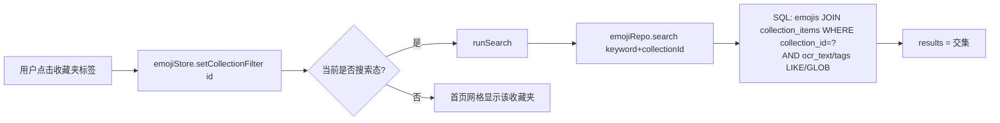

## 用户需求

在首页实现「收藏夹标签筛选」与「搜索框」的联动：用户点击首页上方某个收藏夹标签进入筛选态后，若搜索框同时有内容，搜索结果只在该收藏夹范围内匹配关键词，只显示二者的交集。

## 产品概述

当前首页的收藏夹筛选（点击标签）与搜索框是两套独立逻辑：搜索结果不理会已选中的收藏夹。本需求让二者联动——已选中收藏夹时，搜索被限定在该收藏夹内取交集；未选中收藏夹时，保持原有搜索行为不变。

## 核心功能

- 选中收藏夹（筛选态，filterCollectionId 非空）且搜索框有内容时，搜索结果 = 该收藏夹内表情 ∩ 关键词（文字/标签）命中，仅显示交集。
- 选中收藏夹时，取消旧的「输入收藏夹名则列出该收藏夹全部表情」合并逻辑，保证结果纯交集。
- 在收藏夹筛选态之间切换（点标签 / 点「显示全部」）时，若当前处于搜索态，立即重跑搜索刷新交集。
- 搜索结果区增加视觉提示「在收藏夹『xxx』中搜索：找到 N 个结果」。
- 未选中任何收藏夹时，搜索行为与原版完全一致（文字/标签命中 + 收藏夹名命中合并），不回退。

## 技术栈选择

- 沿用现有前端栈：Vue 3 + TypeScript + Vite + Pinia + Vue Router + Tailwind CSS。
- 数据层：SQLite（`@capacitor-community/sqlite`），复用现有 `emoji` repository 的 `search()`。
- 原生包装：Capacitor 6，本次不触及原生层。

## 实现方案

### 核心思路

在数据库查询层与首页视图层之间打通「收藏夹筛选」上下文：

1. 扩展 `emojiRepo.search()`，新增可选 `collectionId` 参数。传入时通过 `JOIN collection_items` 将搜索结果限定在该收藏夹内（即交集的「收藏夹」一侧），字段统一用 `e.*` 避免与 JOIN 表列冲突，复用既有 `LIKE` + 模糊 `GLOB` 匹配逻辑作为「关键词」一侧。
2. 改造 `Home.vue` 的 `runSearch()`：当 `emojiStore.filterCollectionId` 非空时，仅调用带 `collectionId` 的 `emojiRepo.search`，**跳过** `searchEmojisByCollectionName`（取消收藏夹名命中合并）；为空时保留原合并逻辑，确保旧行为不回退。
3. 在收藏夹筛选切换点（`onToggleCollection` 与顶部「显示全部」按钮）增加判断：若当前 `searched && hasQuery`，则重跑 `runSearch()`，使网格/结果实时变为交集。
4. 结果区文案从「找到 N 个结果」升级为「在收藏夹『xxx』中搜索：找到 N 个结果」（仅在筛选态显示，从 `collectionStore.collections` 取名称）。

### 关键技术决策

- **交集在 SQL 层完成而非前端过滤**：相比「先查全局搜索结果再按收藏夹过滤」，JOIN 方案一次查询即可，结果集更小、无需二次遍历，且天然复用 `deleted_at = 0` 过滤与排序规则，避免 N+1 与内存过滤开销。
- **收藏夹名命中合并仅「选中收藏夹时」关闭**：未选中时保留原行为，最小化回归面；选中时关闭该分支，既满足纯交集语义，也避免关键词碰巧匹配到「其他」收藏夹名而把无关表情混入。
- **复用既有模糊匹配（`buildFuzzyGlob`）**：交集中文 OCR 错别字容错不受影响。

## 实现注意事项

- 不改动 `searchEmojisByCollectionName`，仅在使用处按 `filterCollectionId` 条件跳过调用。
- 新增 `JOIN collection_items ci ON ci.emoji_id = e.id` 时所有 `emojis` 列需用 `e.*` 选取（`toRecord` 依赖完整字段），避免 `SELECT *` 与 JOIN 表列歧义。
- 切换筛选后重跑搜索走防抖外的同步 `runSearch()`，沿用 `searching`/`searched` 状态，无需新增 loading 态。
- 保持所有搜索路径统一 `deleted_at = 0`，不显示已删除表情。
- 按项目强制规范，交付前必须递增 `android/app/build.gradle` 的 `versionCode`(+1) 与 `versionName`（语义化），先读文件再改。

## 架构设计

数据流（选中收藏夹时）：



未选中收藏夹时，`runSearch` 仍走原 `search` + `searchEmojisByCollectionName` 合并分支。

## 目录结构

```
src/
├── db/
│   └── repositories/
│       └── emoji.ts          # [MODIFY] 扩展 search() 增加可选 collectionId 参数；命中时 JOIN collection_items 限定收藏夹，字段用 e.*；保留 LIKE+GLOB 模糊匹配与 deleted_at=0 过滤
├── views/
│   └── Home.vue              # [MODIFY] 改造 runSearch()（选中收藏夹时仅文字/标签匹配并集跳过收藏夹名合并）；筛选切换点（onToggleCollection / 显示全部）在搜索态重跑 runSearch；结果区增加「在收藏夹xxx中搜索」提示文案；引入 collectionStore 取收藏夹名
android/
└── app/
    └── build.gradle          # [MODIFY] 第 18-19 行 versionCode +1、versionName 语义化递增（项目强制规范）
```

## 关键代码结构

```ts
// src/db/repositories/emoji.ts —— search() 扩展签名（仅新增可选字段）
export async function search(params: {
  keyword?: string
  limit?: number
  offset?: number
  collectionId?: string   // 新增：非空时仅在该收藏夹内匹配，取交集
}): Promise<EmojiRecord[]>
```